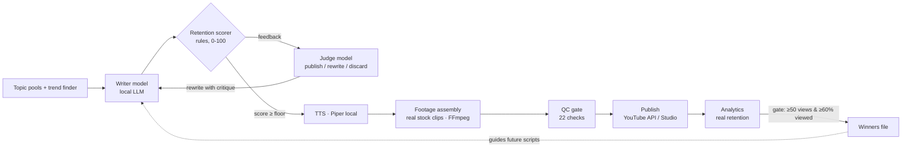

# ShortsForge AI

**An autonomous YouTube Shorts studio that runs entirely on local AI models.**
It writes scripts with a *writer–judge loop*, voices them locally, assembles real-footage vertical video, quality-checks every piece against retention rules, and — only when a published video proves **very high real retention** — teaches itself from its own winners.

No cloud LLM bills. No GPU required. Runs on a Mac, a Windows PC, or a Linux box.

> 🇪🇸 **Resumen en español:** estudio autónomo de YouTube Shorts que corre 100% con modelos locales: un modelo escribe el guion, otro lo juzga (más un medidor de retención por reglas), se reescribe hasta acercarse a 100/100, se produce el video con voz local y metraje real, y el sistema solo aprende de los videos que demuestran retención real muy alta. Guía completa abajo; ajustes de idioma y nicho en `config.yaml`.

---

## Why this exists

Most "AI YouTube automation" stacks fail in the same three ways:

1. **One-shot scripts.** A single prompt produces a mediocre script and it ships.
2. **Learning from noise.** The system "optimizes" based on whatever happened, including flops.
3. **Cloud lock-in.** Every script costs API tokens, forever.

ShortsForge fixes all three:

- **Writer–Judge loop** — a local writer model drafts the script; a deterministic retention scorer grades it (hook, rhythm, open loop, loop-closing, duration) and a second local model (the *judge*) rules *publish / rewrite / discard*. The writer rewrites with both critiques, up to N attempts, targeting **100/100** and keeping the best.
- **A hard learning gate** — the system only updates its own guidance from videos whose *real* YouTube retention clears a strict bar (default: ≥50 views **and** ≥60% average percentage viewed). Everything else is treated as noise and changes nothing.
- **Local-first** — any OpenAI-compatible endpoint works: Ollama, LM Studio, llama.cpp server, vLLM, or a custom gateway (e.g. Hermes). Speech is Piper TTS (CPU). Rendering is FFmpeg (CPU).

## Architecture



## Features

- 🎬 **Full pipeline**: trends → script → voice → footage → render → thumbnail/title → QC → upload → analytics
- ⚖️ **Writer–Judge loop** with a 0–100 retention rubric and a second-model judge (`tools/judge_loop.py`)
- 📈 **Self-improvement with a hard gate** (`tools/self_improve.py`) — learns only from proven high-retention winners
- 🗣️ **Local neural TTS** via Piper (many languages; Spanish `es-MX` by default)
- 🎞️ **Real-footage format**: licensed stock clips (Pexels), fluid 4–6 s cuts, burned subtitles, end card
- 🧩 **Editorial mix engine**: configurable category rotation (e.g. money 40% / AI 30% / business 20% / life 10%)
- 🛡️ **QC by rules, not vibes**: hook-without-context, jargon explained, no sales language, sources with dates, audio loudness (−14 LUFS), retention score floor
- 🔁 **Long-form series support** + "clean master → Shorts/TikTok clips" mirror derivatives
- 💸 **Revenue estimator** per piece (CPM/RPM scenarios) to pivot by money, not vanity views

## Quickstart

### Requirements

- Python 3.11+, FFmpeg, Git
- A local model server (pick one — see [docs/LOCAL_MODELS.md](docs/LOCAL_MODELS.md)):
  - **Ollama** (easiest, Mac/Windows/Linux) — `ollama pull qwen2.5:14b` or any strong instruct model
  - **LM Studio** — load a model and start the local server
  - **llama.cpp / vLLM / Hermes gateway** — any OpenAI-compatible `/v1/chat/completions`
- A Piper voice (download from the Piper voices repo) — optional if you only generate scripts
- A Pexels API key (free) for stock footage — optional for script-only use

### Install

```bash
git clone https://github.com/jcarvajalantigua/shortsforge-ai.git
cd shortsforge-ai
python -m venv .venv && source .venv/bin/activate   # Windows: .venv\Scripts\activate
pip install -r requirements.txt
cp .env.example .env          # set your model endpoint + keys
cp config.example.yaml config.yaml
```

### Generate a judged script (the core loop)

```bash
python tools/judge_loop.py "The credit mistake that silently lowers your score"
# [judge] attempt 1: score 65 ... judge: rewrite
# [judge] attempt 2: score 84 ... judge: publish
# RESULT: score 84 | attempts 2 | mode llm-hermes-jev
```

### Run the daily pipeline

```bash
python tools/run_pipeline.py --help
python tools/self_improve.py   # applies the retention gate to content/analytics.csv
```

## Configuration

Everything lives in `config.yaml` (see `config.example.yaml`):

| Area | Keys |
|---|---|
| Local LLM | `llm.endpoint`, `llm.model`, `llm.timeout_sec` (env `LOCAL_LLM_BASE_URL` wins) |
| Judge loop | `judge.target_score` (100), `judge.max_attempts`, `judge.floor` (70) |
| Retention gate | `self_improve.min_views` (50), `self_improve.min_pct_viewed` (60) |
| Editorial mix | `editorial.mix`, `editorial.rotation_window` |
| Voice | `tts.voice`, `tts.speed` (calibrated per voice) |
| Publishing | `automation.auto_publish` (off until you connect your own channel OAuth) |

Secrets go in `.env` only — never in `config.yaml`, never in code.

## Project layout

```
tools/
  judge_loop.py        writer–judge loop (writer model + rule scorer + judge model)
  script_generator.py  one-shot generation + templates fallback
  retention_optimizer.py  the 0–100 retention rubric
  self_improve.py      hard-gated learning from real retention
  trend_finder.py      fresh-topic discovery (RSS + pools)
  tts_generator.py     Piper local TTS
  footage_assembler.py real-footage Short assembly (FFmpeg)
  render_core.py / layout.py   shared rendering engine
  title_thumbnail.py   titles + thumbnails
  uploader.py          YouTube Data API v3 upload (dry-run by default)
  analytics_tracker.py / revenue_estimator.py
automation/
  qc.py                the 22-check quality gate
  supervisor.py        editorial-mix + freshness supervision
  report.py            daily report
content/               topic pools, scripts, analytics (your data — git-ignored by default)
examples/              sample topics, a sample judged script, sample winners file
docs/LOCAL_MODELS.md   Mac / Windows / Linux model setup recipes
```

## The retention rubric (0–100)

| Block | Points | What earns them |
|---|---|---|
| Hook (0–3 s) | 30 | Question, number, or concrete promise — no greetings, no "in this video" |
| Rhythm | 20 | ≥5 short segments; a new idea every 5–7 s |
| Open loop | 15 | Early promise/question paid off at the end |
| Loop closing | 15 | Ending hands the opening question back to the viewer |
| Duration | 20 | 35–55 s spoken (Shorts sweet spot) |

## Honest limitations

- The 0–100 score is a **structural proxy**, not measured retention. The system treats it that way: real learning is gated on real Analytics retention.
- Local model quality varies; small models (<7B) usually need the full rewrite loop to clear the floor. A 14B–32B instruct model is the sweet spot.
- Publishing by API requires **your own** Google Cloud OAuth client; a browser-assisted Studio flow is the fallback.
- Stock footage requires respecting each clip's license; the assembler records source + license in a manifest per video.

## Contributing

Issues and PRs welcome — especially: new judge rubrics, new TTS voices calibration, additional model-server recipes, and render-format variants. Keep the rule: **no hardcoded hosts, IPs, keys, or personal data in code** — configuration and `.env` only.

## License

MIT — see [LICENSE](LICENSE).

---

*Built from a production system that runs a real channel end-to-end every day: topic → judged script → voice → footage → QC → publish → retention-gated self-improvement.*
